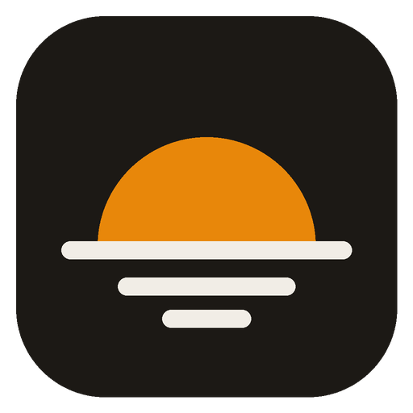
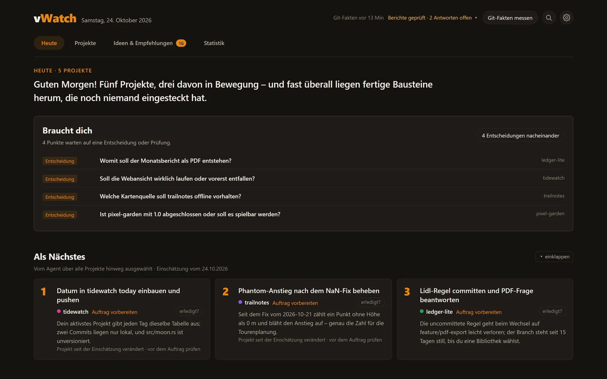
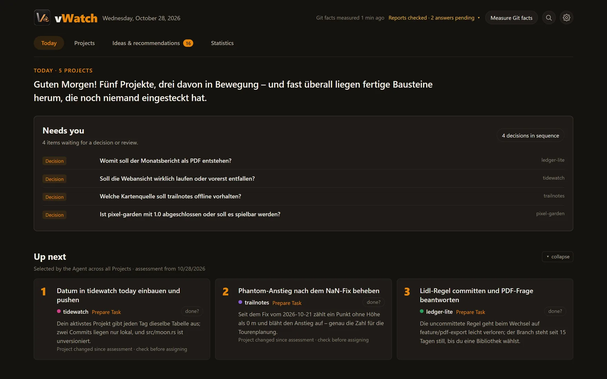
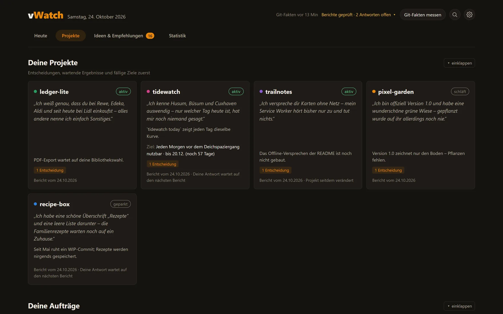
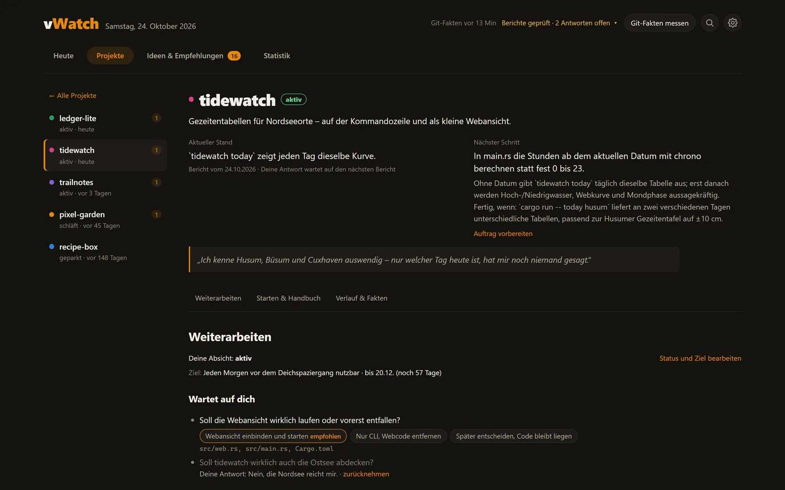
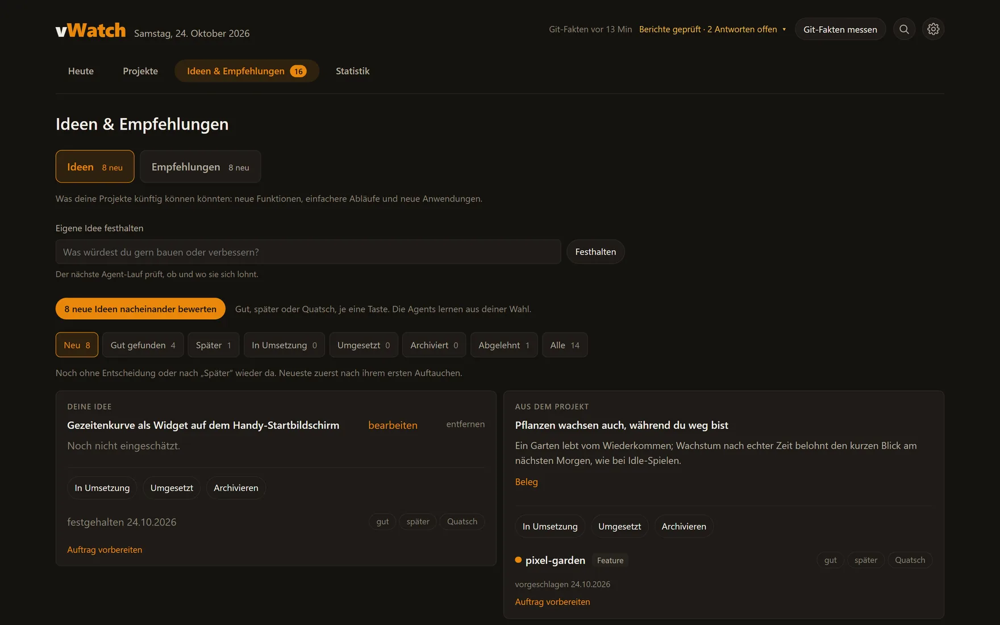

<p align="center">
  
</p>

<h1 align="center">vWatch</h1>

<p align="center"><strong>A morning overview of all the software projects your coding agents work on.</strong></p>

<p align="center">
  vWatch measures every repository with Git and lets your own coding agent (Claude Code, Codex, vBot or any agent that can run a command) write a short report per project.
  Each morning you see what changed, what waits for your decision and what to hand to an agent next. Your ratings teach the agent what you care about.
</p>

<p align="center">
  <a href="https://github.com/Vironnimo/vWatch/releases"></a>
  <a href="LICENSE"></a>
  
  
</p>

<p align="center">
  <a href="#get-started">Get started</a> ·
  <a href="#features">Features</a> ·
  <a href="#a-closer-look">Screenshots</a> ·
  <a href="docs/usage.md">User guide</a> ·
  <a href="#security-and-privacy">Security</a>
</p>

**For many projects at once.** When agents work on eight projects in parallel, it is hard to remember where each one stands, which branch is half done and which question an agent left for you. vWatch keeps that in one window, so a project you haven't touched for a month is quick to pick up again.

**Measured facts, your agent's judgement.** vWatch itself only measures: commits, uncommitted and unpushed work, branches, worktrees and CI state. It never calls a model and never writes to your repositories. The assessment comes from the agent you already use, which reads the repository and saves its report through the `vwatch` CLI.

<p align="center">
  
</p>

> [!NOTE]
> The window and new agent reports default to English. Choose English or German in Settings → Language; saved content keeps its original language. The CLI, documentation and agent instructions are in English. The screenshots below show the English interface with German example reports.

## Features

<table>
<tr>
<td width="50%" valign="top"><b>One report per project</b><br>Your agent writes a Card for each project: where it stands, the next step, open ends and the questions it has for you.</td>
<td width="50%" valign="top"><b>Facts it measures itself</b><br>Uncommitted files, unpushed commits, unmerged branches, extra worktrees and failing CI come straight from Git and <code>gh</code>, never from a model.</td>
</tr>
<tr>
<td valign="top"><b>Focus across projects</b><br>A daily portfolio brief names up to three things to focus on, patterns across projects, and projects worth parking or reviving.</td>
<td valign="top"><b>Only what changed</b><br><code>vwatch due</code> tells the agent which projects changed, so the daily run reviews only those. "Since your last read" lists what is new in the reports.</td>
</tr>
<tr>
<td valign="top"><b>Your decisions stick</b><br>Rate each suggestion good, later or nonsense. The agent reads every rating, never brings back a rejected idea and learns your taste across projects.</td>
<td valign="top"><b>Hand work to an agent</b><br>Turn a suggestion into a task with reason and completion criterion and paste it into your agent. Its report waits for your confirmation.</td>
</tr>
<tr>
<td valign="top"><b>A handbook for re-entry</b><br>Each project page shows how to start the project, where things are and what to read first, with a copy button per command.</td>
<td valign="top"><b>History and statistics</b><br>Every saved change is recorded: compare and restore Card versions, undo your own changes. Statistics show source lines, languages and commits over time, and keep unknown values unknown.</td>
</tr>
</table>

## Get started

vWatch runs on Windows 11 and needs [Git](https://git-scm.com/download/win) on your PATH. The [GitHub CLI](https://cli.github.com/) is optional and adds CI status.

1. **Install.** Download the zip from [Releases](https://github.com/Vironnimo/vWatch/releases), extract it and run its installer from that folder:

   ```powershell
   powershell -ExecutionPolicy Bypass -File .\install.ps1
   ```

   It copies `vWatch.exe` and `vWatch-UI.exe` to `%LOCALAPPDATA%\Programs\vWatch` and adds a Start menu entry. You can read `install.ps1` before you run it; it changes no other system settings. Run it again from a newer package to update; your data stays. The executables are not signed, so Windows SmartScreen may warn when you first open vWatch: choose "More info", then "Run anyway".

2. **Pick your projects.** Open vWatch from the Start menu. In the settings (gear icon), choose your projects folder with "Choose folder …" and tick the repositories to watch. Turn on "Available to Agents" there, so agents can run `vwatch` from any terminal.

3. **Connect your agent.** vWatch writes its [operating Skill](skill/vwatch/SKILL.md) to `%LOCALAPPDATA%\Programs\vWatch\skill\vwatch`. Point your agent at that `SKILL.md`, or copy the folder into its skills folder, for Claude Code `%USERPROFILE%\.claude\skills\vwatch`. Then ask it:

   ```text
   Do the daily vWatch run.
   ```

   The agent studies each project and saves its Cards and the brief, and the window shows them within seconds. Schedule the same prompt daily in your agent app to get a fresh overview every morning.

**From source.** With the Rust toolchain from `rust-toolchain.toml`, the MSVC build tools and Python, `scripts\install.ps1` in a checkout builds both executables and installs them the same way. [CONTRIBUTING.md](CONTRIBUTING.md) covers development.

## A closer look

### Today

"Today" starts with what needs you: questions an agent left, results waiting for your confirmation and the brief's focus for the day. "Prepare Task" turns a focus item into a task for your agent. Routine Git activity never pushes a project to the top; unread reports and outdated reports are marked separately.



### All projects

"Projects" shows one tile per project with its status, the agent's one-line assessment and the decisions waiting for you. Each project also gets a short voice in the first person, which makes it easy to tell projects apart at a glance.



### A project page

Each project gets a page with its purpose, current state and next step, your goal and the questions waiting for you, each with the agent's recommended answer. Further down follow the open ends, the agent's suggestions, the handbook with how to run the project and what to read first, and the facts Git measured.



### Ideas and recommendations

Product ideas and recommendations such as upkeep and repairs are kept apart, each with its own rating round: press 1 for good, 2 for later, 3 for nonsense and optionally add a reason. Ratings are kept with the stable item, also after a later report drops it.



## Security and privacy

- **Local only.** vWatch keeps its data in a SQLite database in `%LOCALAPPDATA%\Programs\vWatch\data`. It has no account, no telemetry and no server. Its only network access is the optional `gh` call for CI status.
- **Read-only on your repositories.** vWatch runs read-only Git commands. The window opens links and folders only when you click them, and shows files in Explorer instead of running them.
- **The CLI trusts your Windows account.** Any program running as you can read and change vWatch's data through `vwatch`, the same way your agent does. That is the intended design.
- **Reports can quote your code.** Cards contain what your agent wrote about your repositories. The operating Skill tells agents to keep credentials and personal content out of them; treat the data folder like the repositories themselves.

Please report vulnerabilities as described in [SECURITY.md](SECURITY.md).

## Documentation

| Goal | Start here |
| --- | --- |
| Learn every part of the window | [User guide](docs/usage.md) |
| See what an agent is told | [Operating Skill](skill/vwatch/SKILL.md) and the [CLI reference](skill/vwatch/references/cli.md) |
| Build on the CLI | [Agent interface specification](docs/agent-interface.md) |
| Build, test or contribute | [CONTRIBUTING.md](CONTRIBUTING.md) |

`vwatch --help` and `vwatch <command> --help` describe every command.

## Status

vWatch is alpha software by a single maintainer, built for daily use with coding agents. It runs on Windows 11 only. Versions are 0.x, so the CLI and document formats may still change between releases. Bugs and ideas are welcome in [Issues](https://github.com/Vironnimo/vWatch/issues). If vWatch is useful to you, a star helps others find it.

## License

[MIT](LICENSE)
